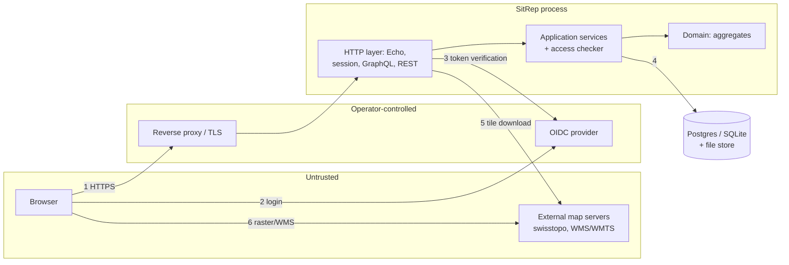

# Security Assurance Case

This document argues why SitRep meets its security requirements. It covers the threat model, the
trust boundaries, how secure design principles were applied, and how the common implementation
weaknesses are countered. Each claim names the code, test or CI check that backs it, so the argument
can be checked. Known gaps are listed in [Known limitations](#known-limitations); they are part of
the case, not hidden from it.

Related documents: [Backend Architecture](Backend%20Architecture.md), [RBAC](RBAC.md),
[Releasing](Releasing.md), [Verifying releases](https://sitrep.ch/docs/admin/how-to/releases-pruefen/),
[Security Policy](../../.github/SECURITY.md).

## 1. Security requirements

SitRep is a situation-reporting tool for civil-protection organisations. The journal, the map and the
resource lists of an incident can be sensitive and operationally critical. The requirements are:

| # | Requirement |
|---|---|
| R1 | Only authenticated users can use the system. |
| R2 | A user can read or change an incident only as far as its access mode and their role allow (see [RBAC](RBAC.md)). |
| R3 | Data cannot be altered or deleted silently; every change is attributable to an actor. |
| R4 | A user cannot make the browser of another user run attacker-controlled code (XSS, CSRF). |
| R5 | Uploaded files cannot be used to attack other users or the server. |
| R6 | The software that operators run is the software the project built (supply chain). |
| R7 | The system keeps working for authorised users: a single request cannot exhaust it, and it keeps its map when the internet is not reachable. |
| R8 | Vulnerabilities can be reported privately and are fixed in the supported release. |

## 2. Threat model

### Assets

- Incident data: journal messages, attachments, map layers and features, resources, divisions.
- The event log, which is the source of truth (see [Backend Architecture](Backend%20Architecture.md)).
- Identities and sessions of users, and the role grants that decide what they may do.
- Secrets: OIDC client secret, cookie key, database credentials.
- The release artefacts (binaries, container image, Helm chart).

### Attackers considered

| Attacker | Capabilities | Example goals |
|---|---|---|
| Anonymous outsider | Can reach the HTTP port, no account. | Read or change incidents, find a way past login. |
| Authenticated user without a grant | Valid session, no role on a restricted incident. | Read or change an incident they may not see; escalate their own role. |
| Authenticated user with a limited role | e.g. viewer. | Write, delete or change access beyond the role. |
| Malicious content author | Can write messages, upload files, name layers. | Stored XSS, malicious file delivery, abuse of the file store. |
| Remote attacker against a user | Controls a web page the user visits. | CSRF against the session, cross-site requests. |
| Network attacker | Can observe or modify traffic between the components. | Steal sessions, tamper with tiles or tokens. |
| Supply-chain attacker | Controls or compromises a dependency, a CI action or a release. | Ship a modified binary or image. |

### Out of scope

- A malicious or compromised operator, or a compromised host or database: whoever runs the server and
  database controls the data.
- A malicious identity provider: the OIDC provider is trusted to authenticate users.
- Denial of service by network-level flooding; this belongs to the reverse proxy and the platform.
- Availability of third-party services (swisstopo, WMS/WMTS servers).

## 3. Trust boundaries

| # | Boundary | What crosses it | Control |
|---|---|---|---|
| 1 | Browser → server | All requests, bodies, uploads, headers | TLS at the proxy or in the server (`server/tls.go`); session check on every `/api/v2` request; input validation in the domain; see section 5 |
| 2, 3 | Server ↔ OIDC provider | Authorisation code flow, ID token | Code flow with PKCE, state, token verified against the issuer (`server/auth/oidc.go`) |
| 4 | Server → database / file store | Commands, events, queries, blobs | Parameterised SQL only; file store confined to its root; the database is trusted to the same degree as the server |
| 5 | Server → swisstopo | Tile archives (opt-in) | Fixed upstream host, ETag and size validation before a file is served (`internal/adapter/outbound/tileupstream/swisstopo`) |
| 6 | Browser → external map servers | Tile and image requests | Direct from the browser; no credentials or session are sent; restricted by the Content-Security-Policy |

The inner boundary is between the HTTP layer and the application services: everything that arrives is
untrusted until the service has checked the actor's access and the aggregate has validated the
command.

## 4. Secure design principles

| Principle | How SitRep applies it |
|---|---|
| **Complete mediation** | Every `/api/v2` route sits behind `RequireLogin`. Access to an incident is checked in the application service through `outbound.IncidentAccessChecker` (`internal/core/port/outbound/access.go`) on each call, not once per session. Attachments are authorised per request and sent with `Cache-Control: no-store`, so a revoked grant takes effect at once. |
| **Least privilege** | Four incident roles (viewer, editor, manager, owner) and global roles; deleting an incident is limited to owners even in open incidents. A principal holds exactly one role per incident. The `all` principal is capped at viewer/editor. See [RBAC](RBAC.md). |
| **Fail-safe defaults** | Without OIDC configuration the server refuses to start unless `--insecure-local-auth` is set explicitly (`internal/cli/serve.go`). Cookies are `Secure`, `HttpOnly` and `SameSite=Lax`. CORS is off unless origins are configured. GraphQL introspection and the playground are off unless enabled. Downloading map tiles is off by default. |
| **Economy of mechanism** | One event-sourced write path for all changes; hexagonal layers with a small number of ports. Authorisation facts are themselves events, so they follow the same path. |
| **Separation of privilege / layers** | The domain has no infrastructure imports, enforced by the `depguard` linter (`.golangci.yaml`). Mutation resolvers never read from the read model, so authorisation and state do not depend on the asynchronous projection. |
| **Open design** | The source, the architecture and this case are public; security does not rely on obscurity. Signing keys are never in the repository (keyless Sigstore). |
| **Accountability / auditability** | Every event records the actor and the time; the event log is append-only, with optimistic concurrency per stream. Deletes are events, not row removals. |
| **Defence in depth** | Content-Security-Policy, `X-Content-Type-Options`, an upload type allow-list, a content-sniffed type check and per-request authorisation protect attachments together. |
| **Psychological acceptability** | Roles are few and named in the UI; the default access template can be set by an administrator, so safe behaviour does not depend on each user. |

## 5. Countering common implementation weaknesses

The table follows the OWASP Top 10 (2021) and the most relevant CWE classes.

| Weakness | How it is countered | Evidence |
|---|---|---|
| **Broken access control** (A01, CWE-285, CWE-639) | Checks in the service layer for each command and query; IDs are UUIDs that grant nothing by themselves; roles live in the event log and are evaluated by Casbin for restricted incidents. | `internal/core/service/*`; RBAC tests in `internal/core/service` and the resolver tests |
| **Cryptographic failures** (A02, CWE-327, CWE-330) | No passwords stored. Sessions are encrypted and signed with `gorilla/securecookie` using keys derived with SHA-256; random values come from `crypto/rand`; TLS uses Go's `crypto/tls` defaults. | `server/auth/oidc.go`, `internal/cli/serve.go` |
| **Injection** (A03, CWE-89, CWE-78) | SQL uses parameters (`pgx`, `database/sql`); a search finds no SQL built with string formatting. gqlgen types every GraphQL input. No shell commands are run with user input. | `grep` in CI review; `gosec` in `golangci-lint` |
| **Cross-site scripting** (A03, CWE-79) | React escapes output; the UI has no `dangerouslySetInnerHTML` or `innerHTML`. A Content-Security-Policy restricts script sources to `'self'`. Attachments cannot be SVG or HTML (allow-list, checked on the sniffed type), are served with `nosniff` and a fixed content type. | `ui/index.html`, `server/attachments.go`, `internal/core/domain/message/message.go` |
| **Cross-site request forgery** (CWE-352) | Cookies are `SameSite=Lax`. GraphQL accepts only `POST` with a JSON body, which a cross-site form cannot send without a CORS preflight. Uploads require a custom `X-Sitrep-Upload` header, which forces a preflight. CORS is closed by default. | `server/options.go`, `server/attachments.go`, `server/routes.go` |
| **Insecure design / business-logic abuse** (A04) | Invariants live in the aggregates and are covered by tests (for example a triaged message keeps its time, merged sites reject resources). Cross-stream invariants use explicit guards. | `internal/core/domain`, [AGENTS.md](../../AGENTS.md) |
| **Security misconfiguration** (A05) | Secure defaults (section 4); partial OIDC configuration is rejected at startup; `middleware.Secure()` sets the standard security headers. | `internal/cli/serve.go`, `server/routes.go` |
| **Vulnerable and outdated components** (A06) | Dependabot for Go, npm, Docker and GitHub Actions; dependency review on pull requests; CodeQL; SBOMs in every release. | `.github/dependabot.yml`, `.github/workflows/` |
| **Authentication failures** (A07) | Authentication is delegated to an OIDC provider using the code flow with PKCE and state; the session is a signed and encrypted cookie. No local password database. | `server/auth/oidc.go` |
| **Software and data integrity failures** (A08, CWE-494) | Release tags and checksums are signed, the image is signed, and build provenance is attested; the release workflow refuses unverified tags. Downloaded tile archives are validated before use. | [Releasing](Releasing.md), [Verifying releases](https://sitrep.ch/docs/admin/how-to/releases-pruefen/) |
| **Logging and monitoring failures** (A09) | Structured `slog` with trace correlation, OpenTelemetry traces, metrics and logs; unexpected errors are logged, expected domain errors are returned to the caller. Secrets are not logged. | [AGENTS.md](../../AGENTS.md) (Logging) |
| **Server-side request forgery** (A10, CWE-918) | The server makes no outbound request to a user-supplied URL. The only outbound HTTP client targets the configured OIDC issuer and the fixed swisstopo host. External map URLs are fetched by the browser, not the server. | `server/auth`, `internal/adapter/outbound/tileupstream` |
| **Path traversal** (CWE-22) | The file store is opened with `os.OpenRoot` (Go confines all access to the root) and builds paths from UUIDs only; the filename given by the user is never used as a path, and is stripped of unsafe characters for the download header. | `internal/adapter/outbound/blobs/filesystem/store.go`, `server/attachments.go` |
| **Unrestricted upload / resource exhaustion** (CWE-434, CWE-400) | Upload type allow-list, a configurable size limit enforced while streaming, a compensating delete if it is exceeded. GraphQL operations are limited by a complexity budget (`FixedComplexityLimit`). | `server/attachments.go`, `server/options.go` |
| **Race conditions** (CWE-362) | Optimistic concurrency on event streams, locks for gapless counters and incident hierarchy; the Go tests run under the race detector in CI. | `.github/workflows/go-workflow.yml` |
| **Memory safety** (CWE-119/787) | Go and TypeScript: memory-safe languages; the repository imports no `unsafe` package, and `gosec` would flag it. | `.golangci.yaml` |

### Verification in the development process

- Static analysis on every pull request: CodeQL, `golangci-lint` (`gosec`, `staticcheck`, `depguard`,
  `sloglint`, …), oxlint with strict TypeScript.
- Tests for the domain, services, GraphQL resolvers and the HTTP handlers, at about 82 % statement
  coverage, run under the race detector.
- Two-person review: every change needs a review by a maintainer who is not the author
  (see [GOVERNANCE.md](../../GOVERNANCE.md)).
- OpenSSF Scorecard runs on the repository.

## Known limitations

These are known and accepted or planned; none is hidden. The fixable ones are tracked in [#2152](https://github.com/f-eld-ch/sitrep/issues/2152).

1. **Content-Security-Policy is delivered as a `<meta>` tag** (`ui/index.html`) and is wider than
   necessary: `img-src` and `connect-src` allow any `https:` origin (needed for user-configured WMS
   and WMTS map layers), `connect-src` also allows `data:` and `blob:` (the map export reads the
   images it has made itself; neither reaches the network), `style-src` allows `'unsafe-inline'`, and `script-src-elem` still lists
   `https://api.mapbox.com`. A `meta` policy cannot set `frame-ancestors`. A policy sent as an HTTP
   header, with the Mapbox entry removed, is a planned improvement.
2. **No application-level rate limiting.** Login throttling and request limits are left to the
   identity provider and the reverse proxy. The GraphQL complexity budget bounds a single operation,
   not the request rate.
3. **SitRep does not send `Strict-Transport-Security`.** `middleware.Secure()` is used with its defaults, which leave HSTS off. The reverse proxy has to set the header until a server option exists.
4. **Without a configured cookie key, a random key is generated at startup.** Sessions then end on
   restart and are not valid across replicas. Production setups set `cookie-key`.
5. **Open-operational incidents give every authenticated user read, write and manage rights**, by
   design (see [RBAC](RBAC.md)). Operators who need stricter handling choose the restricted mode or
   a restricted default-access template.
6. **A PDF attachment is shown inline** in the browser's own viewer. Active content in PDFs is
   handled by the browser's sandbox.
7. **The database and the host are trusted.** Event-log integrity is not protected against someone
   with write access to the database.
8. **Cryptographic agility** is limited to what Go's standard library and the OIDC provider offer;
   SitRep does not define its own algorithms or protocols.

Vulnerabilities are reported through the private reporting feature described in the
[Security Policy](../../.github/SECURITY.md).

## Maintaining this document

Review it when the authentication flow, the access model, the upload handling, the tile
handling or the release process change, and before each major release. A change that moves a trust
boundary or adds a way for outside data to enter the system should update sections 2 to 5 in the
same pull request.
