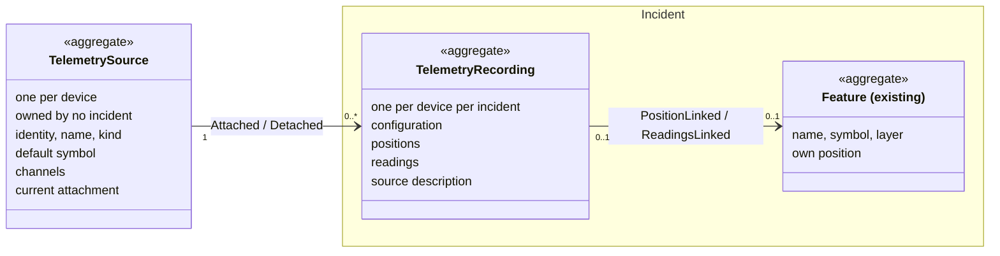
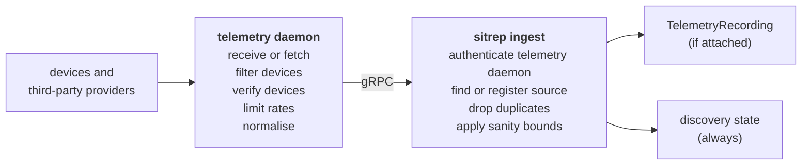

# Automatic Telemetry Events

## Overview

The Einsatzjournal holds hand-written messages. Telemetry adds machine input from devices such as vehicle trackers and dose-rate probes. This document describes how their positions and readings enter sitrep, how they are recorded per incident and shown on the map, and who may do what with them. The design is heavily influenced by [APRS](https://www.aprs.org/doc/APRS101.PDF), which has carried this kind of traffic for decades.

---

## Terms

A **device** is a piece of hardware that sends positions or readings on its own: a vehicle tracker, a handheld, a drone, a dose-rate probe, a weather station, a water gauge. Network elements that only relay data, such as a LoRaWAN gateway, a router or a repeater, are not devices.

A **sample** is what a device measured at one time: a position and/or sensor readings.

The **discovery state** is kept outside any incident, per device: the latest position, the latest readings, the time of the latest sample and the device's clock offset.

---

## Model

A fact about the device goes on the `TelemetrySource`; what it sent during an incident goes on the `TelemetryRecording`; how it is shown on the map goes on the `Feature`.

| Aggregate | Owned by | Retention |
|---|---|---|
| `TelemetrySource` | no incident | never archived; holds no positions or readings |
| `TelemetryRecording` | its incident | archived and deleted with the incident |
| `Feature` | its incident | archived and deleted with the incident |

Ownership uses the existing mechanism: an owned aggregate implements `eventsourcing.Owned`, which lists its stream under the incident in `eventsourcing.aggregate_index`, and archiving an incident moves the listed streams to `archive_events`.

### `TelemetrySource`

An aggregate, one stream per device; "source" for short. Its id is derived from the device's identity type and identity, like `feature.DeriveID`, so ingest finds a device's source without a lookup.

| Field | Meaning |
|---|---|
| identity | IMEI, callsign-SSID or DevEUI |
| name | recognisable in discovery, e.g. "Tracker Peli 4" |
| kind | tracker, probe, gauge, weather station |
| default symbol | taktisches Zeichen used when the source is attached with a new `Feature` |
| channels | the quantities it reports, see below |

A source reports zero or one position: latitude, longitude, accuracy, fix type, and optionally course, speed and altitude. Position is not a channel, because it decides where the source is on the map rather than being a quantity to chart.

A channel is a declaration on the source: label, description, unit, value type and plausibility bounds. Value types are numeric, boolean and enum. An enum channel declares labelled states instead of a unit. Readings arrive normalised to engineering units (see [Ingesting](#ingesting)). Bounds only reject implausible values.

| Event | Data |
|---|---|
| `Registered` | identity, kind, name, default symbol |
| `Updated` | name, kind, default symbol |
| `ChannelAdded` / `ChannelUpdated` | channel declaration |
| `Attached` / `Detached` | incident, recording id |
| `Unregistered` | — |

### `TelemetryRecording`

An aggregate, one stream per source per incident, holding what that source sent while attached to that incident. Its id is derived from the source and the incident, like `feature.DeriveID`, so re-attaching a source to the same incident continues the same stream.

A recording is self-describing through `SourceDescribed`, so an exported or archived incident is complete without the source stream.

Its configuration says what is recorded: the linked `Feature`, if any, whether the position is recorded, and which channels are. See [Attaching](#attaching).

| Event | Written | Data |
|---|---|---|
| `SourceDescribed` | on attach; when the source changes while attached | identity, kind, name, channels |
| `Configured` | on attach; when the configuration changes; on detach | feature id, position on/off, channels — empty on detach |
| `PositionRecorded` | by ingest, if the position is recorded | `{lat, lon, accuracy, fixType, course?, speed?, altitude?}` |
| `ReadingsRecorded` | by ingest | `[{channel, value, unit}]`, the recorded readings of one sample |

A reading's `value` matches its channel's value type: a number, a boolean, or an enum state's key as a string. The unit is on every reading, so a reading stays correct when its channel's declaration changes.

Positions and readings carry protocol, gateway, clock source, raw payload and, if the time was replaced, the original time as metadata.

### `Feature`

The existing aggregate for a drawn object on a layer. It gains links to a recording:

| Event | Written | Data |
|---|---|---|
| `PositionLinked` / `PositionUnlinked` | position recording switched on / off for this `Feature`; relinked; detached | recording id |
| `ReadingsLinked` / `ReadingsUnlinked` | readings switched on / off for this `Feature`; relinked; detached | recording id |

How the links behave is described in [Attaching](#attaching).

---

## Attaching

Attaching a source to an incident is a command. The operator chooses a `Feature`, or none, and toggles the position and each channel; only what is switched on is recorded. Recording starts at attach; nothing the source measured before enters the incident.

| `Feature` | Linked to | Position on the map |
|---|---|---|
| linked, position on | existing, or new with the source's name and default symbol | follows the recorded positions |
| linked, position off | existing | the `Feature`'s own, moved by operators |
| none | — | none; where such a source is shown is left to the UI |

Each command writes all affected streams in one transaction, as the incident service does for `Incident` and `IncidentAccess`. Events are written only by commands and by ingest, never in reaction to other events, so replay reproduces the state and creates nothing.

A source is attached to at most one incident at a time: one device in two incidents would mean two command structures claiming it. Because the current attachment is on the `TelemetrySource`, this is an ordinary aggregate invariant. Child-incident layers shown in the parent are not a second attachment.

### Position on the map

While `PositionLinked`, the `Feature`'s position on the map comes from the recording's `PositionRecorded` events, not from the `Feature` itself, so the `Feature` rejects `Moved`. Name and symbol change with `Restyled` as usual; the layer is fixed, as for any `Feature`.

A `Feature` created on attach is `Placed` without geometry, and a `Feature` without geometry is not shown on the map.

### Ending a position link

When a command ends a `Feature`'s `PositionLinked` state — by turning the position off, relinking the source to another `Feature`, or detaching it — it writes `PositionUnlinked` and, before it, one of:

- a `Moved` to the position with the latest `OccurredAt` recorded for this `Feature`, so it stays where the source was last seen;
- nothing, if no position was recorded and the `Feature` has its own geometry;
- `Removed`, if no position was recorded and the `Feature` has no geometry. Readings still linked to the removed `Feature` are unlinked as well.

On message map layers, every `Feature` change normally references the message it was drawn for, in `MessageID`. The `Moved` written when a position link ends has no such message. It references that `PositionRecorded` instead, by its recording id and version, in a separate optional field, and takes effect at that position's `OccurredAt`. Exactly one of the two references is set.

### Detaching

Detaching ends recording until the source is attached again. The `Feature` is unlinked as above; unless removed, it remains on its layer as an ordinary `Feature`. Other commands also detach:

- Removing a linked `Feature`. With the position on, the `Moved` precedes `Removed`, so `Restored` brings it back where the source was last seen, without re-attaching.
- Closing an incident detaches all its sources. Reopening does not re-attach. The close command finds the incident's recordings through a new outbound port over `eventsourcing.aggregate_index`, which the event store writes synchronously, and detaches every source currently attached to the incident in the same transaction. It is the first command on an incident that writes other aggregates.
- Unregistering a source, when its device is de-provisioned.

---

## Ingesting

The telemetry daemon is an external service: it receives or fetches data from devices and third-party providers — for example over APRS-IS, MQTT, LoRaWAN or a web API — normalises it into positions and readings in engineering units, and calls sitrep's gRPC ingest API, an inbound adapter specified separately.

The ingest API has at least these calls:

| Call | Carries |
|---|---|
| announce a device | identity type, identity, name, kind, channels |
| de-provision a device | identity type, identity |
| send samples | per sample: identity type, identity, `OccurredAt`, clock source, position and/or readings, metadata |

A call is acknowledged once its effects are stored; a telemetry daemon retries until it is.

Ingest updates the discovery state with every sample newer than the one it holds. If the source was attached to an incident at the sample's `OccurredAt`, ingest appends the sample to that incident's recording for the source, limited to the position and channels switched on in the `Configured` in effect at that time (see [Attaching](#attaching)); otherwise it stores nothing else. The discovery state is written directly by ingest, not projected, because it also covers unattached sources, whose data are not events.

If a reading's unit differs from the channel declaration, ingest records the reading as sent and writes a `ChannelUpdated` with the new unit.

### Trust

The telemetry daemon, not the device, is authenticated by sitrep; the telemetry daemon vouches for the sources in its payload. Devices are verified by the telemetry daemon or the system it receives data from, as far as the protocol allows: a LoRaWAN network server checks device keys, APRS has nothing to check. sitrep holds no per-device credentials.

### Provisioning

Devices are provisioned in the telemetry daemon, whose configuration also limits what it forwards, for example by region or callsign for a provider such as aprs.fi. Ingest registers a source when the telemetry daemon announces a provisioned device, or when data arrives from a device without a registered source, named from that data. The announcement carries the device's channels; for a device registered from its data, they come from the readings received. When a device is de-provisioned, the telemetry daemon announces that and ingest unregisters its source, detaching it first if it is attached, and removes it from the discovery state. Data already recorded in incidents is unaffected. If the device is provisioned again, it gets its previous source back, with its channels.

### Rates

Without bounds, a device sending every second would produce almost 30,000 samples in eight hours. Rates are limited per device in the telemetry daemon: positions with [SmartBeaconing](https://www.qsl.net/n2ixd/digitraker/smartbeaconing.htm) — rare when parked, frequent at speed, extra on turns — readings about once a minute, and enum channels on change and periodically.

Ingest only applies a generic sanity bound: a sample whose `OccurredAt` is less than about 10 s from another recorded sample of the same source is dropped, against misbehaving devices and telemetry daemons; a buffer sent after an offline period is kept.

A recording then grows by at most about 120 events per hour, under 10,000 over a three-day incident. Ingest loads the recording for every sample, replaying its events. With recordings bounded as above, this is acceptable at first; if load latency is measured to matter, `outbound.SnapshotStore` (so far only no-op implementations) is the remedy. Operator commands rarely write to a recording, so on a version conflict with incoming telemetry the service retries.

### Duplicates

Ingest derives a key from each sample's source, `OccurredAt`, position and readings, and drops a sample whose key it has already recorded in the same recording. A telemetry daemon can therefore retry a send safely, and the same sample relayed by two telemetry daemons is stored once — unless the source sends no time, since each telemetry daemon then supplies its own receive time.

### Time and device clocks

`PositionRecorded` and `ReadingsRecorded` carry `OccurredAt`, the device time of the sample, and `RecordedAt`, when it was stored. Ordering is by `OccurredAt`; late arrival, e.g. a buffer sent after a device was offline, is normal. A recording's versions follow arrival order, not `OccurredAt`: anything that depends on time — the recording's own state, the read models — orders by `OccurredAt`; a version only identifies an event.

The telemetry daemon states the clock source with each sample, since a device can lose GNSS and fall back to its own clock:

| Clock source | `OccurredAt` |
|---|---|
| `gnss`, `ntp`, `rtc` (the device's free-running clock) | as sent |
| `none` | the telemetry daemon's receive time |

The following applies to every sample:

- Upper bound: `OccurredAt` may be at most the time ingest receives the sample plus about a minute. Later values are replaced by that time, with the original time kept in metadata.
- No lower bound: the attachment check above also drops samples with a clock reset to 1970 or a week-number rollover.
- Ingest counts, per source, the samples it drops — from before the attach, too frequent, duplicate — and the samples whose time it replaced, as OTel metrics, so a device whose samples are all dropped is visible outside the incident.
- The discovery state shows each source's clock offset, `RecordedAt − OccurredAt`. A constant offset, especially in whole hours, indicates a misconfigured clock and is reported as an OTel metric with a `Warn` log and flagged in discovery; a shrinking one is a buffer being sent. sitrep never corrects offsets.

---

## Map and Read Models

| Projection handler | Writes |
|---|---|
| `LayerFeaturesHandler` | `readmodel.layer_features` — existing, gains `TelemetryRecording` |
| `ReadingHandler` | `readmodel.reading` — reading series for charts |
| `SourceRegistryHandler` | `readmodel.telemetry_source` — registrations, channels, current attachment |

A linked `Feature`'s row in `readmodel.layer_features` combines name and symbol from the `Feature`, the latest readings while readings are linked, and the position with the latest `OccurredAt` while the position is linked. A late position never moves the `Feature` back, and once the position link has ended, no further `PositionRecorded` moves it, even one taken while it was linked.

Reading series are per `Feature`: a reading belongs to the `Feature` linked at its `OccurredAt`, also if it arrives late. A source without a `Feature` has one series per recording.

The existing layer query serves the map unchanged; GraphQL gains read-only queries for sources, discovery and reading series.

At about one position per minute, twenty vehicles cause one layer update every three seconds, which the current projection handles. Much higher rates would need the map to fetch only changed features instead of the whole layer.

---

## Permissions

| Action | Who |
|---|---|
| provision and de-provision devices in the telemetry daemon | `system_admin`; the means are not decided yet |
| change a source's name, kind and default symbol; see the full discovery state, with positions and clock offsets | `system_admin` |
| attach, configure, detach | new incident action `telemetry.attach`: owner, manager, editor |
| pick a source while attaching | the same, from a list with name, kind, last seen and availability, without positions |
| see recorded data | whoever may read the incident's layers |

The full discovery state covers every device on the instance, including other organisations', so incident roles never see it.

---

## Examples

In the tables, `Feature`s are referred to by name.

### A sensor box at two measuring points

A portable box with GNSS, a water-level probe and a battery sensor is provisioned in the telemetry daemon. In the incident "Hochwasser Thur", an operator places a `Feature` "Messpunkt 1" on the map and attaches the box to it, recording only the water level; the box's GNSS is not used. Later the box is carried to a second point. The operator places a `Feature` "Messpunkt 2" and links the box to it, without detaching it from the incident. Messpunkt 1 keeps the water level measured there; Messpunkt 2's series starts after the move.

| Step | `TelemetrySource` | `TelemetryRecording` | `Feature` |
|---|---|---|---|
| box provisioned in the telemetry daemon | `Registered`, `ChannelAdded` ×2 | | |
| operator places "Messpunkt 1" | | | Messpunkt 1: `Placed` |
| attached to Messpunkt 1; position off, water level on | `Attached` | `SourceDescribed`, `Configured`(Messpunkt 1, off, [water_level]) | Messpunkt 1: `ReadingsLinked` |
| box sends | | `ReadingsRecorded`(water_level); position and battery dropped | |
| operator places "Messpunkt 2" | | | Messpunkt 2: `Placed` |
| box relinked to Messpunkt 2 | | `Configured`(Messpunkt 2, off, [water_level]) | Messpunkt 1: `ReadingsUnlinked` · Messpunkt 2: `ReadingsLinked` |
| box sends | | `ReadingsRecorded`(water_level) | |

### A truck that parks in a shelter

Truck TLF 21 has a tracker with GNSS and a sensor for the water left in its tank. An operator attaches the tracker with a new `Feature`, recording position and tank level. The `Feature` appears on the map with the first position and follows the truck as it drives to the incident; the operator renames it. The truck then parks in a shelter where GNSS is useless, so the operator switches the position off: the `Feature` stays where the truck was last seen, and the tank level keeps coming. When the incident is closed, the tracker is detached and its `Feature` remains on the map.

| Step | `TelemetrySource` | `TelemetryRecording` | `Feature` |
|---|---|---|---|
| tracker provisioned in the telemetry daemon | `Registered`, `ChannelAdded`(tank_level) | | |
| attached with a new `Feature`; position on, tank level on | `Attached` | `SourceDescribed`, `Configured`(TLF 21, on, [tank_level]) | `Placed` (without geometry), `PositionLinked`, `ReadingsLinked` |
| truck drives | | `PositionRecorded` …, `ReadingsRecorded`(tank_level 2400 l) | (shown on the map from the first position) |
| operator renames it | | | `Restyled` |
| parked in the shelter; position switched off | | `Configured`(TLF 21, off, [tank_level]) | `Moved`(last position), `PositionUnlinked` |
| incident closed (`Closed` on the `Incident`) | `Detached` | `Configured`(empty) | `ReadingsUnlinked` |

---

## Future Work

### Telemetry daemon

A UI for provisioning devices in the telemetry daemon, ahead of an incident or during it, for an organisation's own devices and third-party sources. A catalogue of providers — MeteoSchweiz, aprs.fi, Flightradar24 — could make theirs available with little configuration.

A static clock offset per device, configured in the telemetry daemon, for devices whose clocks cannot be fixed.

### sitrep backend

A rule turns telemetry into a journal message, a derived entry, when a person could act on it: a dose rate crossing 5 µSv/h, a vehicle entering the Bereitschaftsraum, a drone silent for ten minutes. Positions and readings themselves never become journal entries. Silence is also how the map can show a position as stale.

Known constraints:

- Evaluation belongs in the service layer. A projection that emitted messages would emit them again on every rebuild.
- Idempotency keys: `(recording, version)` for event-triggered rules, `(rule, incident, window start)` for scheduled ones; a rule never reacts to its own output.
- Hysteresis: a value oscillating around a threshold must not emit an immutable, numbered message per crossing, so a rule needs a dwell time or reset band and armed/triggered state.
- Periodic summaries are protocol records, not monitoring, so their interval should be long, e.g. hourly.
- Open: whether periodic entries are auto-triaged, and what a scheduled rule emits when nothing arrived.

A recording starts at attach, and sitrep keeps no history for unattached sources. Bringing earlier data into an incident would require keeping it, or fetching it from the telemetry daemon or the provider.

### sitrep UI

Discovery, the attach dialog, naming sources, and where sources attached without a `Feature` are shown.

Sources can also be attached through a Mittel. `Resource` is currently created inside an incident. Once Mittel can be created ahead of time, a Mittel can list its sources: alerting it into an incident attaches them with a default configuration, name and symbol, and `Relieved` detaches them. Manual attach remains for sources without a Mittel, such as a MeteoSchweiz weather station.

The Nachrichtenkarte shows the map at a past time, but `readmodel.layer_features` holds only a source's latest position. Showing where a source was at that time needs its positions over time.
