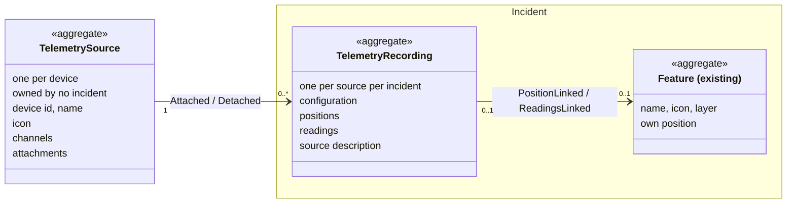
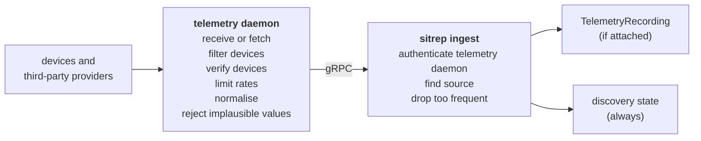

# Automatic Telemetry Events

## Overview

The Einsatzjournal holds hand-written messages. Telemetry adds machine input from devices such as vehicle trackers and dose-rate probes. This document describes how their positions and readings enter sitrep, how they are recorded per incident and shown on the map, and who may do what with them. The design is heavily influenced by [APRS](https://www.aprs.org/doc/APRS101.PDF), which has carried this kind of traffic for decades.

---

## Terms

A **device** is a piece of hardware that sends positions or readings on its own: a vehicle tracker, a handheld, a drone, a dose-rate probe, a weather station, a water gauge. Network elements that only relay data, such as a LoRaWAN gateway, a router or a repeater, are not devices. In sitrep, a device is represented by its **source**, see [`TelemetrySource`](#telemetrysource).

A **sample** is what a device measured at one time: a position and/or sensor readings.

The **discovery state** is kept outside any incident, per source: the latest position, the latest readings and the time of the latest sample.

---

## Model



A fact about the device goes on the `TelemetrySource`; what it sent during an incident goes on the `TelemetryRecording`; how it is shown on the map goes on the `Feature`.

| Aggregate | Owned by | Retention |
|---|---|---|
| `TelemetrySource` | no incident | never archived; holds no positions or readings |
| `TelemetryRecording` | its incident | archived and deleted with the incident |
| `Feature` | its incident | archived and deleted with the incident |

Ownership uses the existing mechanism: an owned aggregate implements `eventsourcing.Owned`, which lists its stream under the incident in `eventsourcing.aggregate_index`, and archiving an incident moves the listed streams to `archive_events`.

### `TelemetrySource`

An aggregate, one stream per device; "source" for short. Its id is derived from the device id, like `feature.DeriveID`, so ingest finds a device's source without a lookup.

| Field | Meaning |
|---|---|
| `device_id` | the device's id in its protocol, unique among all devices, e.g. an IMEI, callsign-SSID or DevEUI |
| `name` | recognisable in discovery, e.g. "Tracker Peli 4" |
| `icon` | used for a `Feature` created when the source is attached; opaque to sitrep, stored as sent |
| `channels` | the quantities it reports, see [Channel](#channel) |

A source reports zero or one position. Position is not a channel, because it decides where the source is on the map rather than being a quantity to chart.

| Event | Data |
|---|---|
| `Registered` | device id, name, icon |
| `Updated` | name, icon |
| `ChannelAdded` / `ChannelUpdated` | channel declaration |
| `ChannelRemoved` | channel id |
| `Attached` / `Detached` | incident, recording id |
| `Unregistered` | — |

#### Channel

A channel is a quantity the source reports, declared on the source.

| Field | Meaning |
|---|---|
| `channel_id` | unique within the source; never changes; readings refer to it |
| `label` | a [label](#translated-text); may change |
| `type` | `numeric` or `enum` |
| `unit` (numeric only) | a case-sensitive [UCUM](https://ucum.org/ucum) code, e.g. `m`, `L`, `uSv/h`, `Cel` |
| `states` (enum only) | the possible values, each `{id, label}`, with `id` unique within the channel |

```json
{ "channel_id": "water_level", "label": { "de": "Pegel" }, "type": "numeric", "unit": "m" }
{ "channel_id": "gate", "label": { "de": "Schieber" }, "type": "enum",
  "states": [ { "id": "open", "label": { "de": "offen" } },
              { "id": "closed", "label": { "de": "geschlossen" } } ] }
```

Readings arrive normalised to engineering units and checked for plausibility by the telemetry daemon (see [Ingesting](#ingesting)).

### `TelemetryRecording`

An aggregate, one stream per source per incident, holding what that source sent while attached to that incident. Its id is derived from the source and the incident, like `feature.DeriveID`, so re-attaching a source to the same incident continues the same stream.

A recording is self-describing through `SourceDescribed`, so an exported or archived incident is complete without the source stream.

Its configuration says what is recorded: the linked `Feature`, if any, whether the position is recorded, and which channels are. See [Attaching](#attaching).

| Event | Written | Data |
|---|---|---|
| `SourceDescribed` | on attach; when the source changes while attached | device id, name, channels |
| `Configured` | on attach; when the configuration changes; on detach | feature id, position on/off, ids of the recorded channels — empty on detach |
| `PositionRecorded` | by ingest, if the position is recorded | a [position](#position) |
| `ReadingsRecorded` | by ingest | the recorded [readings](#reading) of one sample, without `unit` |

Positions and readings carry the sample's `metadata`.

#### Position

| Field | Meaning |
|---|---|
| `latitude` | decimal degrees, WGS 84, −90 to 90, positive north of the equator |
| `longitude` | decimal degrees, WGS 84, −180 to 180, positive east of Greenwich |
| `accuracy` (optional) | horizontal accuracy in m, at 95 % confidence |
| `altitude` (optional) | m above the WGS 84 ellipsoid |
| `altitude_accuracy` (optional) | accuracy of `altitude` in m, at 95 % confidence |
| `heading` (optional) | direction of travel in degrees, 0 ≤ heading < 360, clockwise from true north; absent when stationary |
| `speed` (optional) | horizontal speed in m/s, non-negative |

As in W3C [`GeolocationCoordinates`](https://www.w3.org/TR/2026/CR-geolocation-20260326/#coordinates_interface), except that `accuracy` is optional and field names are in snake_case.

The telemetry daemon converts heights above mean sea level, as sent by APRS or NMEA `GGA`, to heights above the ellipsoid. Positions are converted for display only, e.g. to swisstopo's LV95 coordinates and LN02 heights, which most users in Switzerland expect.

#### Reading

| Field | Meaning |
|---|---|
| `channel_id` | the channel's id |
| `value` | for a numeric channel, a number; for an enum channel, a state's id. Once recorded, its unit or state is resolved with the channel in the `SourceDescribed` in effect when it was recorded |
| `unit` (numeric only) | the UCUM code of `value`'s unit; must match the channel's `unit`; not recorded |

### `Feature`

The existing aggregate for a drawn object on a layer. It gains links to a recording:

| Event | Written | Data |
|---|---|---|
| `PositionLinked` / `PositionUnlinked` | position recording switched on / off for this `Feature`; relinked; detached | recording id |
| `ReadingsLinked` / `ReadingsUnlinked` | readings switched on / off for this `Feature`; relinked; detached | recording id |

How the links behave is described in [Attaching](#attaching).

### Translated text

sitrep's UI is available in German, French, Italian and English, so text that the telemetry daemon declares and that viewers read must be translatable: the labels of channels and of their states. Such text is always a **label**: a map from two-letter ISO 639-1 language code to text, e.g. `{"de": "Pegel", "fr": "Niveau d'eau"}`. A source's `name`, e.g. "Tracker Peli 4", is a proper name and is not translated.

---

## Attaching

Attaching a source to an incident is a command. The operator chooses a `Feature`, or none, and toggles the position and each channel; only what is switched on is recorded. Recording starts at attach; nothing the source measured before enters the incident.

| `Feature` | Linked to | Position on the map |
|---|---|---|
| linked, position on | existing, or new with the source's name and icon | follows the recorded positions |
| linked, position off | existing | the `Feature`'s own, moved by operators |
| none | — | none; where such a source is shown is left to the UI |

Each command writes all affected streams in one transaction, as the incident service does for `Incident` and `IncidentAccess`. Events are written only by commands and by ingest, never in reaction to other events, so replay reproduces the state and creates nothing.

A source is attached to at most one incident at a time: one device in two incidents would mean two command structures claiming it. Because the current attachment is on the `TelemetrySource`, this is an ordinary aggregate invariant. Child-incident layers shown in the parent are not a second attachment.

### Position on the map

While `PositionLinked`, the `Feature`'s position on the map comes from the recording's `PositionRecorded` events, not from the `Feature` itself. The `Feature` therefore rejects a `Moved` that takes effect while it is `PositionLinked`, also once the link has ended, except the one written when a position link ends. A `Moved` that takes effect outside a link is accepted, for example one for an older message on a message map layer. Name and icon change with `Restyled` as usual; the layer is fixed, as for any `Feature`.

A `Feature` created on attach is `Placed` without geometry, and a `Feature` without geometry is not shown on the map.

### Ending a position link

When a command ends a `Feature`'s `PositionLinked` state — by turning the position off, relinking the source to another `Feature`, or detaching it — it writes `PositionUnlinked` and, before it, one of:

- a `Moved` to the position with the latest `OccurredAt` recorded for this `Feature`, taking effect at that `OccurredAt`, so it stays where the source was last seen;
- nothing, if no position was recorded and the `Feature` has its own geometry;
- `Removed`, if no position was recorded and the `Feature` has no geometry. Readings still linked to the removed `Feature` are unlinked as well.

On message map layers, every `Feature` change normally references a message. A `Feature` change written by attaching, configuring or detaching a source references an event of its recording instead: the `Moved` when a position link ends references the last `PositionRecorded`, every other change the `Configured` written with it.

### Detaching

Detaching ends recording until the source is attached again. The `Feature` is unlinked as above; unless removed, it remains on its layer as an ordinary `Feature`. Other commands also detach:

- Removing a linked `Feature`. Its position link ends as above before it is removed, so `Restored` brings it back where the source was last seen, without re-attaching. The removal takes effect no earlier than that.
- Closing an incident detaches all its sources, also when retention closes it automatically. Reopening does not re-attach. The close command finds the incident's recordings through a new outbound port over `eventsourcing.aggregate_index`, which the event store writes synchronously, and detaches every source currently attached to the incident in the same transaction. It is the first command on an incident that writes other aggregates.
- Unregistering a source, when its device is de-provisioned.

Close is serialised with every other write to the incident's recordings, by commands and by ingest, through a lock per incident on the same port: close takes it exclusively, all other writers shared. Each takes the lock before it checks that the incident is open and holds it until its transaction commits. Optimistic concurrency is not enough, because neither attach nor ingest writes the `Incident`. As with `IncidentHierarchyGuard`, the lock is implemented in the adapters.

---

## Ingesting

The telemetry daemon is an external service: it receives or fetches data from devices and third-party providers — for example over APRS-IS, MQTT, LoRaWAN or a web API — normalises it into positions and readings in engineering units, and calls sitrep's gRPC ingest API, an inbound adapter specified in [gRPC API](gRPC%20API.md).



The ingest API has at least these calls:

| Call | Carries |
|---|---|
| announce a device | `device_id`, `name`, `icon`, `channels`: the source's fields, see [`TelemetrySource`](#telemetrysource) |
| de-provision a device | `device_id` |
| send a sample | a sample |

A sample has these fields:

| Field | Meaning |
|---|---|
| `device_id` | the device id, see [`TelemetrySource`](#telemetrysource) |
| `occurred_at` | an [RFC 3339](https://www.rfc-editor.org/rfc/rfc3339) timestamp in UTC, e.g. `2026-10-24T14:03:00Z` |
| `position` (optional) | a [position](#position) |
| `readings` (optional) | a list of [readings](#reading) |
| `metadata` (optional) | a map of string to string, opaque to sitrep, stored as sent |

A sample has a position, readings or both. As `metadata`, the telemetry daemon may add what helps to trace a sample, such as the protocol, the path it took through repeaters, gateways or networks, or the clock source, e.g. `{"protocol": "aprs", "path": "digi-1,digi-2,igate-1", "clock_source": "gnss"}`.

A call is acknowledged once its effects are stored; a telemetry daemon retries until it is.

Ingest updates the discovery state with every sample newer than the one it holds. If the source was attached to an incident at the sample's `OccurredAt`, ingest appends the sample to that incident's recording for the source, limited to the position and channels switched on in the `Configured` in effect at that time (see [Attaching](#attaching)); otherwise it stores nothing else. An incident that is no longer open is never modified, so a late sample for it is dropped. The discovery state is written directly by ingest, not projected, because it also covers unattached sources, whose data are not events.

A reading that does not match its channel's declaration — another unit, a state the channel does not declare, or a value of the wrong type — is dropped.

### Trust

The telemetry daemon, not the device, is authenticated by sitrep; the telemetry daemon vouches for the devices in its payload. Devices are verified by the telemetry daemon or the system it receives data from, as far as the protocol allows: a LoRaWAN network server checks device keys, APRS has nothing to check. sitrep holds no per-device credentials.

### Provisioning

Devices are provisioned in the telemetry daemon, with their name, icon and channels. The telemetry daemon forwards data only from provisioned devices, and its configuration can limit that further, for example by region or callsign for a provider such as aprs.fi. Ingest registers a source when the telemetry daemon announces a provisioned device; announcing a device whose source is registered updates its name, icon and channels. A channel missing from the announcement is removed. A channel in a `Configured` that the source no longer declares is ignored. A sample from a device without a registered source is dropped. When a device is de-provisioned, the telemetry daemon calls ingest to de-provision it, and ingest unregisters its source, detaching it first if it is attached, and removes it from the discovery state. Data already recorded in incidents is unaffected. If the device is provisioned again, ingest registers its previous source again, because the source's id is derived from the device id.

### Rates

Without limits, a device sending every second would produce almost 30,000 samples in eight hours. Most devices already send at a sensible rate: APRS trackers typically use [SmartBeaconing](https://www.qsl.net/n2ixd/digitraker/smartbeaconing.htm) — rare when parked, frequent at speed, extra on turns — and sensors report about once a minute, enum channels on change and periodically. The telemetry daemon may limit the rate of a device that sends more often than an incident needs.

Ingest limits rates to protect sitrep from overload, whatever devices and telemetry daemons send. It drops:

- a position whose `OccurredAt` is less than 30 s from that of another recorded position of the same source;
- a numeric reading whose `OccurredAt` is less than 30 s from that of another recorded reading of the same channel;
- an enum reading whose channel already has 5 recorded readings with an `OccurredAt` within 60 s of its own, since enum channels can change in bursts.

The position and each reading of a sample are checked separately, so a sample's position can be dropped while its readings are kept. The intervals and the burst size are configurable; the values above are the defaults.

A recording then typically grows by about 120 events per hour, under 10,000 over a three-day incident. Ingest loads the recording for every sample, replaying its events. With recordings growing at this rate, this is acceptable at first; if load latency is measured to matter, `outbound.SnapshotStore` (so far only no-op implementations) is the remedy. Operator commands rarely write to a recording, so on a version conflict with incoming telemetry the service retries.

### Duplicates

A duplicate, such as a retried send or the same sample relayed by two telemetry daemons, has the same `OccurredAt` as the original or one only seconds later, so the rate limits drop it. An enum reading with the same `OccurredAt` as a recorded reading of the same channel is dropped as well.

### Time and device clocks

`PositionRecorded` and `ReadingsRecorded` carry `OccurredAt`, the time of the sample as sent by the telemetry daemon, and `RecordedAt`, when it was stored. Ordering is by `OccurredAt`; late arrival, e.g. a buffer sent after a device was offline, is normal. A recording's versions follow arrival order, not `OccurredAt`: anything that depends on time — the recording's own state, the read models — orders by `OccurredAt`; a version only identifies an event.

The telemetry daemon sets `occurred_at` depending on the device's clock, since a device can lose GNSS and fall back to its own clock:

| Clock source | `OccurredAt` |
|---|---|
| `gnss`, `ntp`, `rtc` (the device's free-running clock) | as sent |
| `none` | the telemetry daemon's receive time |

The following applies to every sample:

- Upper bound: a sample whose `OccurredAt` is more than 60 s later than the time ingest receives it is dropped. The 60 s are configurable, to tolerate skewed clocks. Correcting such a time is up to the telemetry daemon, which may keep the original in `metadata`.
- Lower bound: the attach. A sample from before it is not recorded, also one with a clock reset to 1970 or a week-number rollover.

Detecting misconfigured device clocks, e.g. by a constant offset in whole hours, is up to the telemetry daemon.

### Observability

For each source, ingest counts the positions and readings it records and those it drops. Drops are counted per reason.

---

## Map and Read Models

| Projection handler | Writes |
|---|---|
| `LayerFeaturesHandler` | `readmodel.layer_features` — existing, gains `TelemetryRecording` |
| `ReadingHandler` | `readmodel.reading` — reading series for charts |
| `SourceRegistryHandler` | `readmodel.telemetry_source` — registrations, channels, current attachment |

In `readmodel.layer_features`, a linked `Feature` combines name and icon from the `Feature`, the latest readings while readings are linked, and the position with the latest `OccurredAt` while the position is linked, together with that `OccurredAt`, so the map can show how old the position is.

Reading series are per `Feature`: a reading belongs to the `Feature` linked at its `OccurredAt`, also if it arrives late. A source without a `Feature` has one series per recording. The read models show an enum reading with its state's label.

The existing layer query serves the map unchanged. GraphQL gains queries for sources, discovery and reading series, and mutations to attach, configure and detach a source.

At about one position per minute, twenty vehicles cause one layer update every three seconds, which the current projection handles. Much higher rates would need the map to fetch only changed features instead of the whole layer.

---

## Permissions

| Action | Who |
|---|---|
| provision and de-provision devices, with their name and icon, in the telemetry daemon | `system_admin`; the means are not decided yet |
| see the full discovery state, with positions | `system_admin`; while attaching, whoever may attach |
| attach, configure, detach | new incident action `telemetry.attach`: owner, manager, editor |
| see recorded data | whoever may read the incident's layers |

---

## Examples

In the tables, `Feature`s are referred to by name.

### A sensor box at two measuring points

A portable box with GNSS, a water-level probe and a battery sensor is provisioned in the telemetry daemon. In the incident "Hochwasser Thur", an operator places a `Feature` "Messpunkt 1" on the map and attaches the box to it, recording only the water level; the box's GNSS is not used. Later the box is carried to a second point. The operator places a `Feature` "Messpunkt 2" and links the box to it, without detaching it from the incident. Messpunkt 1 keeps the water level measured there; Messpunkt 2's series starts after the move.

| Step | `TelemetrySource` | `TelemetryRecording` | `Feature` |
|---|---|---|---|
| box provisioned in the telemetry daemon | `Registered`, `ChannelAdded` ×2 | | |
| operator places "Messpunkt 1" | | | Messpunkt 1: `Placed` |
| attached to Messpunkt 1; position off, water level on | `Attached` | `SourceDescribed`, `Configured`(Messpunkt 1, off, [water_level]) | Messpunkt 1: `ReadingsLinked` |
| box sends | | `ReadingsRecorded`(water_level); position and battery not recorded | |
| operator places "Messpunkt 2" | | | Messpunkt 2: `Placed` |
| box relinked to Messpunkt 2 | | `Configured`(Messpunkt 2, off, [water_level]) | Messpunkt 1: `ReadingsUnlinked` · Messpunkt 2: `ReadingsLinked` |
| box sends | | `ReadingsRecorded`(water_level) | |

### A truck that parks in a shelter

Truck TLF 21 has a tracker with GNSS and a sensor for the water left in its tank. An operator attaches the tracker with a new `Feature`, recording position and tank level. The `Feature` appears on the map with the first position and follows the truck as it drives to the incident; the operator renames it. The truck then parks in a shelter where GNSS is useless, so the operator switches the position off: the `Feature` stays where the truck was last seen, and the tank level keeps coming. When the incident is closed, the tracker is detached and its `Feature` remains on the map.

| Step | `TelemetrySource` | `TelemetryRecording` | `Feature` |
|---|---|---|---|
| tracker provisioned in the telemetry daemon | `Registered`, `ChannelAdded`(tank_level) | | |
| attached with a new `Feature`; position on, tank level on | `Attached` | `SourceDescribed`, `Configured`(TLF 21, on, [tank_level]) | `Placed` (without geometry), `PositionLinked`, `ReadingsLinked` |
| truck drives | | `PositionRecorded` …, `ReadingsRecorded`(tank_level 2400 l) | (shown on the map from the first position) |
| operator renames it | | | `Restyled` |
| parked in the shelter; position switched off | | `Configured`(TLF 21, off, [tank_level]) | `Moved`(last position), `PositionUnlinked` |
| incident closed (`Closed` on the `Incident`) | `Detached` | `Configured`(empty) | `ReadingsUnlinked` |

---

## Future Work

### Telemetry daemon

A UI for provisioning devices in the telemetry daemon, ahead of an incident or during it, for an organisation's own devices and third-party providers. A catalogue of providers — MeteoSchweiz, aprs.fi, Flightradar24 — could make theirs available with little configuration.

A static clock offset per device, configured in the telemetry daemon, for devices whose clocks cannot be fixed.

### sitrep backend

A rule turns telemetry into a journal message, a derived entry, when a person could act on it: a dose rate crossing 5 µSv/h, a vehicle entering the Bereitschaftsraum, a drone silent for ten minutes. Positions and readings themselves never become journal entries.

Known constraints:

- Evaluation belongs in the service layer. A projection that emitted messages would emit them again on every rebuild.
- Idempotency keys: `(recording, version)` for event-triggered rules, `(rule, incident, window start)` for scheduled ones; a rule never reacts to its own output.
- Hysteresis: a value oscillating around a threshold must not emit an immutable, numbered message per crossing, so a rule needs a dwell time or reset band and armed/triggered state.
- Periodic summaries are protocol records, not monitoring, so their interval should be long, e.g. hourly.
- Open: whether periodic entries are auto-triaged, and what a scheduled rule emits when nothing arrived.

A recording starts at attach, and sitrep keeps no history for unattached sources. Bringing earlier data into an incident would require keeping it, or fetching it from the telemetry daemon or the provider.

### sitrep UI

Discovery, the attach dialog, and where sources attached without a `Feature` are shown.

Sources can also be attached through a Mittel. `Resource` is currently created inside an incident. Once Mittel can be created ahead of time, a Mittel can list its sources: alerting it into an incident attaches them with a default configuration, name and icon, and `Relieved` detaches them. Manual attach remains for sources without a Mittel, such as a MeteoSchweiz weather station.

The Nachrichtenkarte shows the map at a past time from `readmodel.feature_change`, which holds `Feature` changes but no recorded positions. Showing where a source was at that time needs its positions over time.
